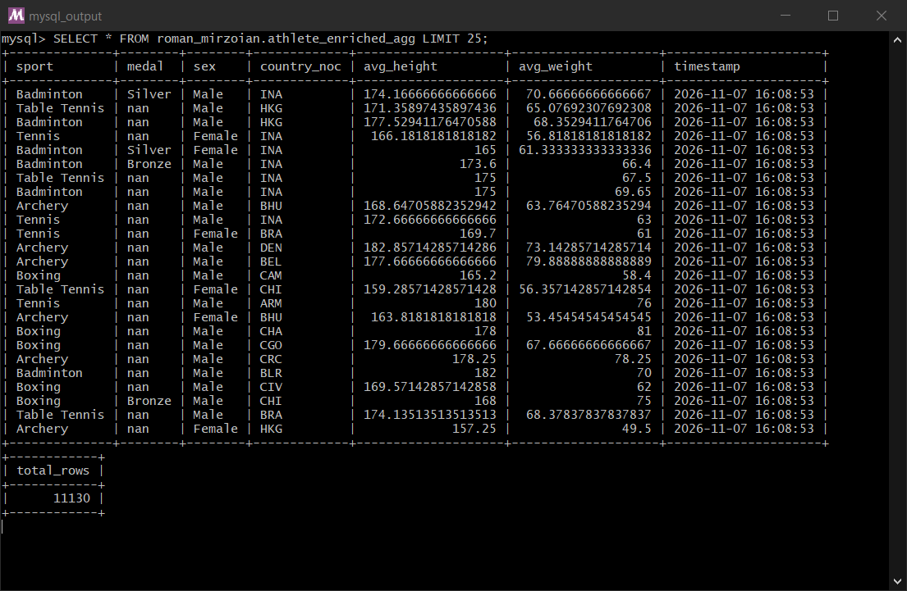
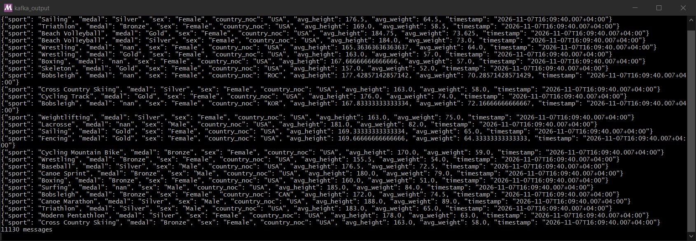
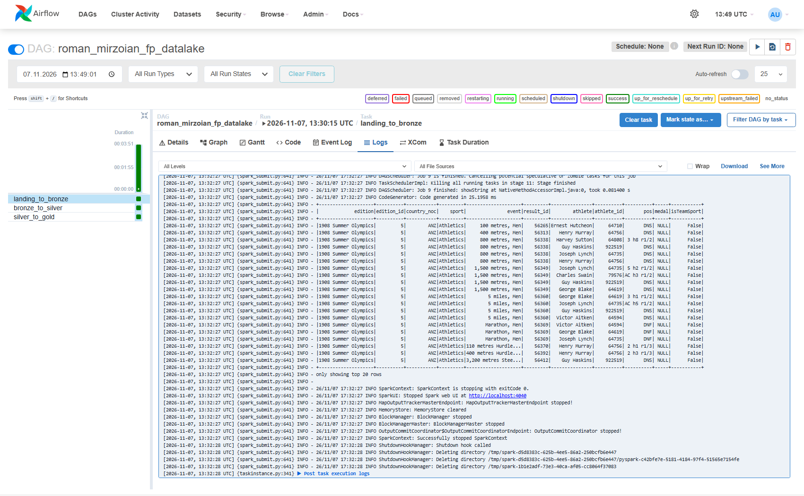
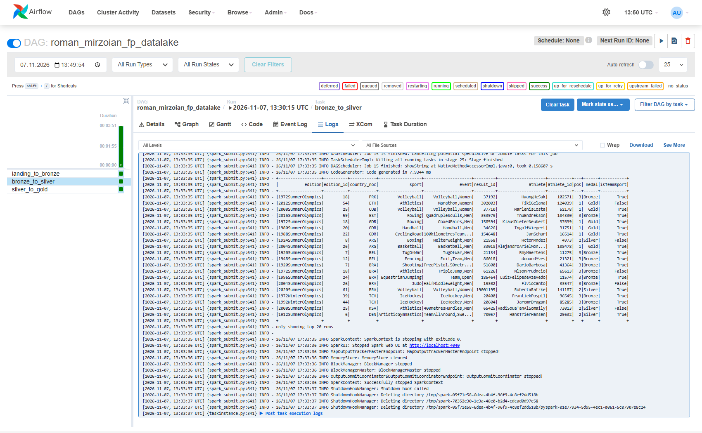
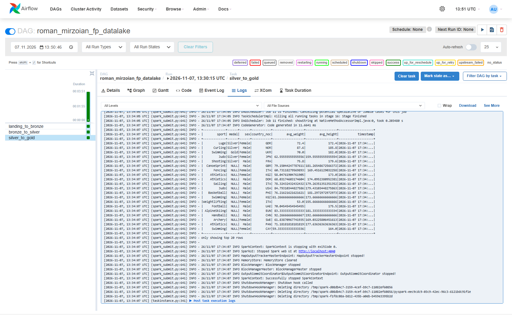
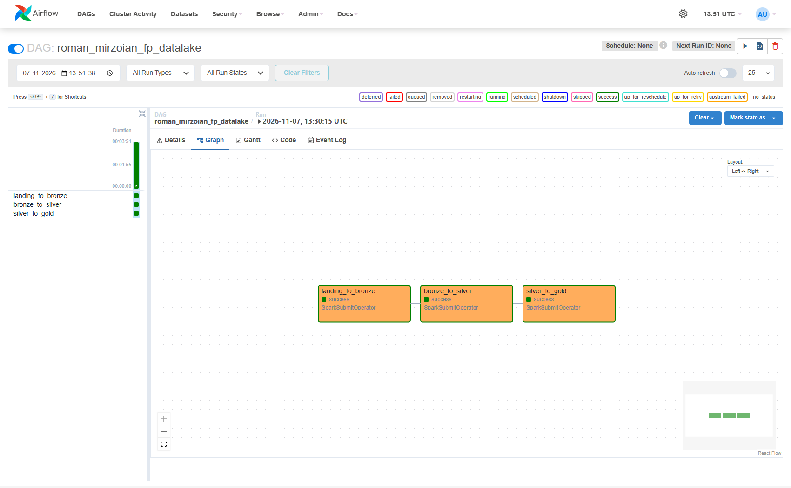

# goit-de-fp

Фінальний проєкт курсу Data Engineering: стрімінговий пайплайн на Spark Structured Streaming + Kafka і batch data lake на Spark + Airflow.

## Структура

```
part1_streaming/
    settings.py                  налаштування MySQL, Kafka і Spark-сесії
    load_athlete_bio.py          завантаження athlete_bio з FTP курсу в MySQL
    event_results_producer.py    athlete_event_results: MySQL -> Kafka
    streaming_pipeline.py        стрімінговий пайплайн (етапи 1-6)
    enriched_topic_reader.py     читання вихідного Kafka-топіку
part2_batch/
    landing_to_bronze.py
    bronze_to_silver.py
    silver_to_gold.py
    project_solution.py          Airflow DAG
jars/                            MySQL JDBC-драйвер (+ Kafka-конектор, див. download_jars.py)
windows_fs/                      локальна файлова система для Spark на Windows без winutils.exe
```

## Частина 1. End-to-End Streaming Pipeline

`event_results_producer.py` зчитує `olympic_dataset.athlete_event_results` з MySQL і записує всі 316 834 записи в Kafka-топік `athlete_event_results` у форматі JSON.

`streaming_pipeline.py`:

1. Зчитує `olympic_dataset.athlete_bio` з MySQL через JDBC.
2. Відкидає атлетів, у яких зріст або вага порожні чи не є числами (`try_cast` до `double` + фільтр `IS NOT NULL`).
3. Зчитує стрім з Kafka-топіку `athlete_event_results` і розбирає JSON у колонки.
4. Об'єднує результати змагань з біоданими за `athlete_id`.
5. Рахує середній зріст і вагу для кожної комбінації `sport`, `medal` (відсутність медалі — `nan`), `sex`, `country_noc` і додає `timestamp` розрахунку.
6. Через `foreachBatch` пише кожен мікробатч у Kafka-топік `athlete_enriched_agg` і в MySQL-таблицю `roman_mirzoian.athlete_enriched_agg`.

Дані оброблено за 6 мікробатчів (по 60 000 повідомлень), у вихідні таблицю й топік записано 11 130 рядків.

Таблиця в MySQL:



Вихідний Kafka-топік:



## Частина 2. End-to-End Batch Data Lake

| Job | Що робить |
|---|---|
| `landing_to_bronze.py` | Завантажує `athlete_bio.csv` і `athlete_event_results.csv` з `https://ftp.goit.study/neoversity/` у `landing/`, читає їх Spark-ом і зберігає в parquet у `bronze/{table}` |
| `bronze_to_silver.py` | Чистить усі текстові колонки функцією `clean_text` (UDF), прибирає дублікати, зберігає в `silver/{table}`. `height` і `weight` перед чисткою приводяться до `double`, інакше значення на кшталт `58-60` перетворилися б на `5860` |
| `silver_to_gold.py` | Об'єднує `silver/athlete_bio` і `silver/athlete_event_results` за `athlete_id`, рахує середні `weight` і `height` для кожної комбінації `sport`, `medal`, `sex`, `country_noc`, додає `timestamp` і зберігає в `gold/avg_stats` |
| `project_solution.py` | DAG `roman_mirzoian_fp_datalake`: три `SparkSubmitOperator` (`conn_id="spark-default"`), що запускаються послідовно |

Результат запуску: `athlete_event_results` після дедублікації — 315 626 рядків (було 316 834), `gold/avg_stats` — 10 879 рядків (атлети без зросту чи ваги в середні не входять).

Вивід `df.show()` у логах кожної задачі:







Граф відпрацьованого DAG:


